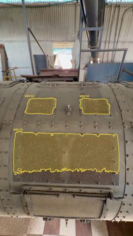

# Walkdown

Walkdown is an agent for **plant and facility walkdowns**: refineries, tank farms, terminals, pump and compressor stations, power plants.

A technician records a handheld video or photos of plant piping, tanks, vessels, valves and supports. Walkdown turns that footage into two things: a **verified defect register** and a **risk-optimal repair plan**. It replans when something changes on site.

Entry in the Meta Global AI Developer Hackathon (Indie Developer track, theme: Push the Frontier). Built during the building period, Oct 27 – Nov 4, 2026.

**Live demo: https://walkdown-zeta.vercel.app/**
- Click **Open finished example** for the complete tank-farm run (instant), or **Run the agent** on a sample (about a minute).
- The free server sleeps after 15 minutes idle. The first visit can show "Waking up the demo server (~1 min)".
- Public demo mode: cached results on samples, upload limits and a $5 daily budget. Details under [Public demo mode](#public-demo-mode).

**Built with Muse Spark Open.** Walkdown's On-prem mode runs the agent, the box proposals and the verifier on Muse Spark Open, and segmentation on SAM 3.1 open weights. No hosted model is called in that mode. Muse Model License; see [THIRD_PARTY_NOTICES.md](THIRD_PARTY_NOTICES.md).

**Decision support only.** Walkdown never operates or controls plant equipment. It proposes a defect register and a repair plan, and every maintenance action needs approval by a qualified person. Read [Limitations and safe use](#limitations-and-safe-use) before relying on it.

## Why

- **Cost.** Corrosion costs an estimated **US$2.5 trillion a year worldwide, about 3.4% of global GDP**. Existing corrosion-control practice could save **15–35%** of that. Those figures exclude safety and environmental consequences. ([NACE IMPACT study, 2016](http://impact.nace.org/documents/Nace-International-Report.pdf))
- **Safety.** When corrosion is missed, people get hurt. The 2012 Chevron Richmond refinery fire endangered 19 workers, and more than 15,000 residents sought medical attention. The safety board's recommendations target "preventing potentially catastrophic sulfidation corrosion failures". ([U.S. Chemical Safety Board](https://www.csb.gov/csb-board-approves-chevron-refinery-final-report-with-a-unanimous-vote/))
- **The gap Walkdown fills.** Long cross-country pipelines are inspected from inside with in-line inspection tools ("pigs"). Plant piping, supports, flanges and tanks that pigs cannot reach are inspected by people walking the plant, and the findings usually end up in notes and spreadsheets.
- **Scope today.** Footage is handheld. Drone and robot footage is future work.

All figures and their exact wording are in [`docs/IMPACT_SOURCES.md`](docs/IMPACT_SOURCES.md).

## How it works

An agent (Muse Spark with tool calling) runs the whole loop and decides what to do next. Every model turn and tool call is shown live in the web UI, with timing and cost.

1. **Perceive.** SAM 3.1 segments candidate corrosion from the text prompt "rust", either on sampled frames or tracked through the video. Muse Spark proposes boxes around rust that the text prompt misses, and SAM 3.1 segments them. The agent starts coarse and looks again at stretches that need it.
2. **Verify and grade.** Muse Spark judges each candidate on a crop with the mask outlined, plus the whole frame. It rejects look-alikes and returns a schema-validated grade: type, severity 1–5, confidence, evidence and recommended action.
   - Rule-based checks flag contradictory grades for review.
   - Severe or uncertain grades get a **second opinion from Muse Wonder**. It does not make grades more accurate: label agreement was 73.5% before and 72.7% after ([RESULTS §5](benchmark/RESULTS.md)). Its job is to surface disagreements, so a defect it disputes stays in the register, marked "needs human review".
3. **Register.** Repeat sightings merge into one entry per defect. The line service (LPG, hydrogen, crude, steam, …) sets a consequence factor.
4. **Plan.** An OR-Tools CP-SAT model schedules repairs and minimises risk-weighted exposure (likelihood × consequence × hours unrepaired). It handles:
   - crews, skills and shift hours;
   - permits, with lead times and concurrency limits;
   - shutdown windows.

   Nearby defects can be grouped into work packages, one crew in one visit. Grouping is used only when the per-defect plan cannot be proven within 5% of optimal in 30 s. The UI shows both plans with their exposure, makespan, gap and setup hours.
5. **Replan.** When a crew drops out, a shutdown window moves or a new defect appears, a two-stage replan keeps started work fixed. It finds the lowest-risk plan, then moves as few jobs as possible within a chosen "stability vs risk" tolerance.
6. **Explain.** The agent explains the plan only through the planner's structured reasons, such as permit lead time, waiting for a window or crew capacity. Solver status and gap are always shown, and a FEASIBLE plan is never called optimal.

**Modes:**
- **Cloud:** hosted SAM 3.1, Muse Spark and Muse Wonder (Meta Model API).
- **On-prem:** open weights only. SAM 3.1 on a scale-to-zero GPU (Modal); Muse Spark Open (Baseten) for the agent, the box proposals and the verifier.

**Detection sensitivity:** "High recall" (default) or "Balanced". The measured trade-off is shown next to each option (see Limitations).

**Also included:**
- an inspector copilot that answers only from the register, the plan and the planner's reasons;
- an inspection report (PDF);
- work orders (CSV and JSON);
- inspector voice notes (Muse Voice Transcribe, then Muse Spark extracts the asset tag, line service, remarks and follow-ups; tested on the builder's own recording, [RESULTS §19](benchmark/RESULTS.md)).

## Results

Full details, including the negative results, are in [`benchmark/RESULTS.md`](benchmark/RESULTS.md) and [`benchmark/PLANNER_RESULTS.md`](benchmark/PLANNER_RESULTS.md).

**Perception on a held-out test split** (1,444 annotated images):

| Pipeline | Images with corrosion found | Pixel precision | Annotated corrosion area covered (pixel recall) |
|---|---|---|---|
| SAM 3.1 text prompt only | 66% | 0.92 | 36% |
| **Cloud** default (text + Muse Spark boxes + verifier) | 97.9% | 0.77 | 84% |
| **On-prem**, open weights only (same pipeline on SAM 3.1 open weights + Muse Spark Open) | 92.4% | 0.78 | 62% |

On-prem finds corrosion on most of the same images but covers less of it: open-weights SAM 3.1 has no per-box prompt, so its masks from box proposals are looser ([RESULTS §7](benchmark/RESULTS.md)).

**Verification against blind human labels** (133 candidates labelled by the builder; [RESULTS §8](benchmark/RESULTS.md)):
- 91–93% of the candidates the verifier accepts are real rust.
- The dataset's own masks miss so much visible rust that 84% of its "false positives" were rust to a person.

**False alarms on 191 real clean-pipe images** ([RESULTS §9](benchmark/RESULTS.md); images with at least one flag):

| Mode and setting | Images flagged |
|---|---|
| Cloud, High recall | 12.0% |
| Cloud, Balanced | 6.8% |
| On-prem | 2.1% |

**Open weights:**
- Muse Spark Open agrees with hosted Muse Spark on 93.4% of 5,066 verification decisions ([RESULTS §6](benchmark/RESULTS.md)).
- **Muse Glimmer 30B distilled as a verifier**, from open-weights teacher labels only ([RESULTS §14](benchmark/RESULTS.md)):
  - Trained twice with the same data: QLoRA on Modal, and LoRA with images on Fireworks Serverless Training (free promotional training; the published recipe is text-only, so Walkdown drives the training API directly). Both keep **99.1%** of audited real rust.
  - Both accept more look-alikes than their teacher. Glimmer v2, with more look-alike rejections, cuts clean-pipe images with an alarm by **39%** at **94.7%** recall, still about 2× the teacher's false alarms.
  - So it is **not used in the product**; it stays a documented research result ([DECISIONS](docs/DECISIONS.md)).

**Reliability:** 50 of 50 live end-to-end agent runs succeeded, 16 of them with a replan after a crew outage; median 143 s and $0.19 per run ([RESULTS §15](benchmark/RESULTS.md)). These runs found one real bug (video tracking), now fixed.

**Negative results we kept:** SAM 3 full fine-tuning never completed (NaN after about 300 steps at any learning rate or precision, after patching three upstream training issues), so SAM 3.1 stays the perception model ([RESULTS §18](benchmark/RESULTS.md)). Muse Wonder's second opinion does not improve grade agreement (§5). More reasoning effort and a hardened prompt did not pay off (§11, §12).

**Planning:**
- CP-SAT is never worse than a severity-first priority sort on 60 generated scenarios: median 5.8% lower risk in the default regime, up to 24.9%.
- After a crew outage on tight-capacity scenarios, the two-stage replan moves about half as many jobs as a replan from scratch: median 7 vs 13 ([PLANNER_RESULTS](benchmark/PLANNER_RESULTS.md)).

## Limitations and safe use

Walkdown assists inspectors; it does not replace them. These limitations apply in both modes.

- **It misses corrosion.**
  - The default pipeline finds corrosion on 97.9% of test images that have it, and covers 84% of the annotated area.
  - It matches only 30% of individually annotated patches as separate instances (instance recall 0.30 at IoU 0.5).
  - A clean register is not evidence of a clean asset.
- **It flags things that are not corrosion,** and the verifier also rejects some real rust. You choose the trade-off with "Detection sensitivity". The measured operating points:

  | Option | Audited real-rust recall (n = 113, 95% CI) | Real clean-pipe images with a false alarm (n = 191, 95% CI) |
  |---|---|---|
  | High recall (default) | 97.3% (92.5–99.1) | 12.0% (8.2–17.4) |
  | Balanced | 93.8% (87.8–97.0) | 6.8% (4.0–11.3) |
  | On-prem | 95.6% (90.1–98.1) | 2.1% (0.8–5.3) |

  The default favours recall because a missed defect is the dangerous error, and every flag is reviewed by a person ([`docs/DECISIONS.md`](docs/DECISIONS.md)).
- **Dusty or discoloured perforated grilles and panels can be flagged as corrosion.**
  - On a stock clip of a vessel with perforated panels, the default setting put 11 entries in the register. The large ones (W01–W03 below) cover dusty grilles, not rust.
  - Their evidence cites colour only ("uniform brown-orange discoloration over mesh").
  - On the same clip, the **Balanced** setting, whose prompt requires a texture cue, kept 3 entries. One of those still looks like a grille panel. This is one clip, not a measured rate.

  

  *Stock demonstration footage: "Industrial facility with large metallic cylinder" by Diego Castro Calderon, [Pexels](https://www.pexels.com/video/industrial-facility-with-large-metallic-cylinder-35069362/) (Pexels License), downscaled frame with Walkdown's mask overlay.*
- **Brown stains are hard.** On generated stress images, brown oil smudges, paint drips and dirt smears are accepted as rust by every verifier ([RESULTS §10](benchmark/RESULTS.md)). Box proposals are the main source of false alarms (§9, §10).
- **Severity grades are not validated for accuracy.** There is no ground truth for severity. Grades are schema-validated and consistency-checked, but a grade is a triage suggestion, not an engineering assessment.
- **Not a substitute for certified inspection programmes.** Walkdown does not perform or replace inspections under API 570 (piping), API 510 (pressure vessels), API 653 (tanks), a risk-based inspection (RBI) programme, wall-thickness measurement or any regulatory requirement.
- **Human approval is required.** The plan is a proposal. Crews, permits, isolations and shutdowns are decided by the site's responsible people. The planner's consequence factors per line service are stated assumptions, not site data.
- **Scope.** Handheld visible-light footage of external surfaces. Walkdown cannot see under insulation, inside pipes or below paint.

## Run it

Requirements: Python 3.12, Node 20+, and API keys in `.env` (copy [`.env.example`](.env.example); never commit `.env`).

```bash
python -m venv .venv && .venv\Scripts\pip install -r requirements.txt   # Windows; use .venv/bin on Linux/macOS
.venv\Scripts\python -m uvicorn backend.api.app:app --port 8000         # API
cd frontend && npm install && npm run dev                                # UI on http://localhost:3000
```

- **Cloud mode** needs `MODEL_API_KEY` (Meta Model API).
- **On-prem mode** needs `BASETEN_API_KEY`, plus a Modal account with the SAM 3.1 app deployed: `modal deploy modal_apps/sam_open.py`, using `HF_TOKEN` for the gated weights.
- **Tests:** `.venv\Scripts\python -m pytest tests`.
- **Benchmarks:** each script in `benchmark/` documents its command, and the results land in `benchmark/results/`.

### Run it locally

The live demo above runs in public demo mode. The demo video was recorded on a local production build. To run it yourself:

1. Follow **Run it** above, with your own `MODEL_API_KEY` in `.env`. The UI opens on **Try a sample walkdown**.
2. The sample walkdowns and their finished examples need the sample data folder (extracted frames and cached model results of three Pexels stock clips, about 21 MB). The stock videos and the cache are not in this repository (Pexels License: no standalone redistribution). Without them the UI shows the upload drop zone only, and uploads run fresh inference.
3. Shareable links: `?sample=<id>` selects a sample, `?example=<id>` opens a finished example (`tank-farm`, `valve-tank`, `clean-piping`), and `?run=<id>` reopens a run while the server keeps it.
4. Rebuild the finished examples (about $0.1 of Meta credit): `python -m backend.api.examples --voice <your voice note>`.

### Public demo mode

`DEMO_MODE=true` makes the API safe to expose (`backend/api/demo.py`). It forces cached results on the samples, turns On-prem runs off, limits uploads (50 MB, 60 s, 20 photos), rate-limits each IP per hour, and applies one global daily spend cap across all providers (`DEMO_DAILY_CAP_USD`, default $5). Agent turns, uploads, voice notes, replans and copilot questions all count toward the cap; past it, those endpoints answer "demo budget reached" and finished examples keep working. The cap is persisted per UTC day in `WALKDOWN_DATA_DIR/demo/`. Voice notes are capped at 10 MB, and oversized uploads are refused before they are read. All settings are in [`.env.example`](.env.example). The live demo runs on a Render free web service (API, Docker) and Vercel Hobby (UI), with the data bundle in a private Hugging Face dataset. The deployment and the measured memory budget are in [`docs/DEPLOY.md`](docs/DEPLOY.md).

## Built during the hackathon

Everything in this repository was written during the building period. The git history shows it.

- **Agent loop:** Muse Spark tool calling, a live trace, replanning and explanation. Plus the inspector copilot, PDF reports and CSV/JSON work orders.
- **Perception:** a hosted SAM 3.1 client, video tracking, Muse Spark box proposals, and the text + boxes merge. Also a SAM 3.1 open-weights app on Modal, with box exemplars matched per box.
- **Verification:** a schema-validated verifier for three providers (Meta, Baseten, Fireworks), consistency checks, the Muse Wonder second opinion with its fail-safe rule, and the detection-sensitivity setting.
- **Planner:** a CP-SAT model (crews, skills, shifts, permits, windows, risk × consequence), a two-stage stability-aware replan, adaptive work packages and a baseline.
- **Evaluation:**
  - deduplicated splits;
  - instance, pixel and image metrics;
  - two blind human audits with a labelling page;
  - false-alarm tests on real and synthetic negatives;
  - effort studies;
  - the Cloud vs On-prem comparison;
  - Muse Glimmer distillation (teacher labels from open weights only): QLoRA on Modal, LoRA with images on Fireworks Serverless Training, and its evaluation;
  - a SAM 3 full fine-tune harness on Modal (negative result);
  - 50 live end-to-end agent runs.
- **Web UI** (Next.js) and the **FastAPI** back end.

## Third-party libraries, models and datasets

### Models and services
| Component | Licence / terms | Use |
|---|---|---|
| SAM 3.1 (`sam-3.1`), Meta Model API | Meta Model API terms | Candidate segmentation and video tracking (Cloud) |
| Muse Spark (`muse-spark-1.3`), Meta Model API | Meta Model API terms | Agent, verifier, box proposals, copilot (Cloud) |
| Muse Wonder (`muse-wonder-1.0`), Meta Model API | Meta Model API terms | Second opinion on severe or uncertain grades |
| Muse Image (`muse-image-1.0`), Meta Model API | Meta Model API terms (evaluation only, §10.1(ix)) | 300 synthetic look-alike images for a false-alarm stress test; never trained on |
| Muse Voice Transcribe, Meta Model API | Meta Model API terms | Technician voice notes |
| SAM 3.1 open weights (`facebook/sam3.1`, code `facebookresearch/sam3`) on Modal | SAM License; Modal terms | On-prem segmentation |
| Muse Spark Open (`meta-models/muse-spark-open-1026` on Baseten; `muse-spark-open` on Fireworks serverless) | Muse Model License and Usage Policy; Baseten / Fireworks terms | On-prem agent, verifier and box proposals; teacher for the Glimmer distillation; full-test-split On-prem benchmark (Fireworks) |
| Muse Glimmer 30B (`meta-models/Muse-Glimmer-30B`) on Modal | Apache 2.0 and the Muse Glimmer Usage Policy; trained on Muse Spark Open outputs, so the Muse Model License applies too | Distilled verifier experiment; weights private, never published |
| Muse Glimmer 30B on Fireworks Serverless Training (`accounts/fireworks/models/muse-glimmer-30b`) | Apache 2.0 and the Muse Glimmer Usage Policy; Fireworks terms | Same distillation trained as a LoRA with images; tuned snapshot private, used only for evaluation |
| SAM 3 open weights (`facebook/sam3`, code `facebookresearch/sam3`) on Modal | SAM License; Modal terms | Fine-tuning attempt (negative result, no checkpoint kept) and base-model comparison |
| FLUX.1-schnell (`black-forest-labs/FLUX.1-schnell`) on Modal | Apache 2.0 | Synthetic look-alike images for training only |

### Libraries
| Library | Licence | Use |
|---|---|---|
| `meta-sam-parser` 0.1.0 (Meta Platforms, Inc.) | **SAM License** (see the package's `licenses/` file) | Parsing and decoding SAM 3.1 output |
| OR-Tools (CP-SAT) | Apache-2.0 | Maintenance scheduling |
| FastAPI, Uvicorn, Pydantic, python-multipart, httpx | MIT / BSD | API |
| OpenAI Python SDK | Apache-2.0 | Client for the OpenAI-compatible Meta, Baseten and Fireworks APIs |
| NumPy, OpenCV, Pillow, pycocotools, ReportLab | BSD / Apache-2.0 / HPND / BSD / BSD | Images, masks, evaluation, PDF |
| Modal client | Apache-2.0 | GPU jobs |
| transformers, PEFT, bitsandbytes, diffusers (in the Modal images only) | Apache-2.0 / Apache-2.0 / MIT / Apache-2.0 | Glimmer fine-tuning, FLUX generation |
| Next.js, React, TypeScript | MIT / MIT / Apache-2.0 | Web UI |
| `fireworks-ai[training]` SDK and the fw-ai cookbook's Muse Glimmer renderer (separate venv on the data drive, not in `requirements.txt`) | Apache-2.0 / Apache-2.0 | Glimmer training on Fireworks Serverless Training (`benchmark/fw_glimmer_train.py`) |
| PyAV (bundles FFmpeg) | BSD-3-Clause (FFmpeg: LGPL) | One-off local conversion of the builder's voice note to WAV; not a project dependency |

### Datasets and footage
| Data | Source | Licence | Use |
|---|---|---|---|
| Corrosion Segmentation v1 (Roboflow Universe, `computervision-adpf6`) | https://universe.roboflow.com/computervision-adpf6/corrosion-segmentation-xybsj | **Public Domain**, as listed by the uploader | Benchmark scoring (deduplicated `valid`/`test`). Distillation training only on a clean train pool, whose near-duplicate clusters are disjoint from test. Never shown in public material. |
| Non-corroded pipe images (Roboflow Universe, `corrosion-detection-sd`) | see [`docs/FOOTAGE_SOURCES.md`](docs/FOOTAGE_SOURCES.md) | CC BY 4.0, as listed | False-alarm scoring only (191 images after dedup). Never trained on, never public. |
| Stock demonstration clips (Pexels) | see [`docs/FOOTAGE_SOURCES.md`](docs/FOOTAGE_SOURCES.md) | Pexels License | Demo fallback, labelled "stock demonstration footage" wherever shown |

Public visuals come from the author's own footage, or from stock demonstration footage labelled as such.

## Licence

MIT, see [LICENSE](LICENSE). Third-party licences and notices: [THIRD_PARTY_NOTICES.md](THIRD_PARTY_NOTICES.md).
